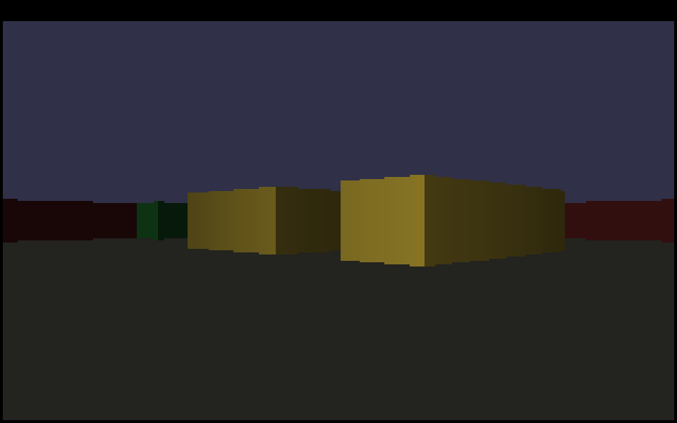
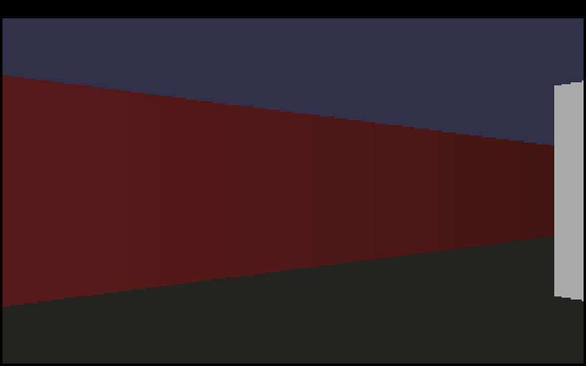

# Raycaster — a maze renderer in hand-written x86-64 assembly

A Wolfenstein-style pseudo-3D maze you walk through, written entirely in
**x86-64 assembly (NASM/Intel syntax) for 64-bit Windows**, with **no C runtime**
— it talks to Win32 directly. The whole "engine" is one tight per-column inner
loop, which is exactly why the efficiency shows up as a huge FPS number.




Measured **~1,200 FPS under Wine's *software* renderer** (no GPU) on a cloud CPU.
On real Windows hardware the same binary runs many times faster — the render loop
is pure CPU work, so it's limited only by how fast the cores can push pixels.

## Controls

| Key            | Action        |
| -------------- | ------------- |
| `W` / `↑`      | forward       |
| `S` / `↓`      | backward      |
| `A` / `←`      | turn left     |
| `D` / `→`      | turn right    |
| `Q`            | strafe left   |
| `E`            | strafe right  |
| `Esc`          | quit          |

The window title shows the live FPS.

## How it works

No game engine, no libraries, no GPU. The pipeline each frame:

1. **Software framebuffer** — a raw `320×200×32bpp` pixel buffer in `.bss`.
2. **Raycasting (DDA)** — for every one of the 320 screen columns, cast one ray
   and grid-march it through a 16×16 map with the
   [DDA algorithm](https://lodev.org/cgtutor/raycasting.html) until it hits a
   wall. The wall's *perpendicular* distance sets the vertical strip height, so
   near walls are tall and far walls are short → perspective. All ray math is
   **SSE double-precision** (`mulsd`/`divsd`/`comisd`); rotation uses the x87
   `fsincos` instruction so there's no dependency on a math library.
3. **Shading** — each strip is darkened by distance, and walls facing the Y axis
   are drawn half-bright, which is what gives the cubes their 3D solidity.
4. **Blit** — the framebuffer is scaled to the window with a single
   `StretchDIBits` call (GDI). Rendering at a low internal resolution and letting
   GDI upscale keeps fill-rate tiny — a deliberate "efficiency lever."

Everything else is raw Win32: `RegisterClassExA` / `CreateWindowExA` for the
window, a non-blocking `PeekMessageA` pump, `GetAsyncKeyState` for input,
`QueryPerformanceCounter` for frame timing, and `SetWindowTextA` for the FPS
readout.

### Why assembly buys FPS here

A raycaster is *compute-bound*: the frame time is dominated by the per-column
ray loop, not by memory or the GPU. That's the ideal case for hand-written asm —
tight register use, no call overhead, no abstraction. The map is bordered by
walls so the DDA always terminates; player state lives in memory so it survives
the volatile-register clobbering of Win32 calls; the hot render loop makes **zero**
calls and touches only registers + the framebuffer.

## Build

### On Windows

You need [NASM](https://nasm.us) and a linker. `build.bat` auto-detects either
[GoLink](https://godevtool.com) (tiny, free) or MSVC's `link.exe`:

```bat
build.bat
```

Or by hand with GoLink:

```bat
nasm -f win64 raycaster.asm -o raycaster.obj
golink /entry start /console raycaster.obj kernel32.dll user32.dll gdi32.dll
```

Or from a Visual Studio **x64 Native Tools** command prompt:

```bat
nasm -f win64 raycaster.asm -o raycaster.obj
link /subsystem:windows /entry:start /nodefaultlib raycaster.obj kernel32.lib user32.lib gdi32.lib
```

### On Linux (cross-compile)

Needs `nasm` and `mingw-w64`:

```bash
sudo apt-get install nasm mingw-w64
./build.sh          # produces raycaster.exe
```

`wine_shot.sh` runs the result headless under Xvfb + Wine and screenshots it —
that's how the images above were captured.

## Tuning knobs (top of `raycaster.asm`)

| `%define`             | Meaning                                          |
| --------------------- | ------------------------------------------------ |
| `RENDER_W`/`RENDER_H` | internal render resolution (fewer pixels = faster) |
| `WIN_W`/`WIN_H`       | window size (framebuffer is stretched to fit)    |

Movement/turn speed and shading distance are the `moveSpeedC` / `rotSpeedC` /
`d_shadeDist` constants in the `.data` section. The maze is the `map` byte array
(0 = empty, 1–5 = wall colours from `palette`).

## Where to take it next

- **Wall textures** — sample a texture column by the exact hit point instead of a
  flat colour (the classic next step; the hit coordinate is already computed).
- **Floor/ceiling casting** — perspective-correct textured floor and ceiling.
- **Sprites + enemies** — billboarded sprites sorted by distance → it becomes a
  shooter.
- **A minimap**, wall-collision radius, mouse-look, or an SSE/AVX pass that casts
  multiple columns at once.
