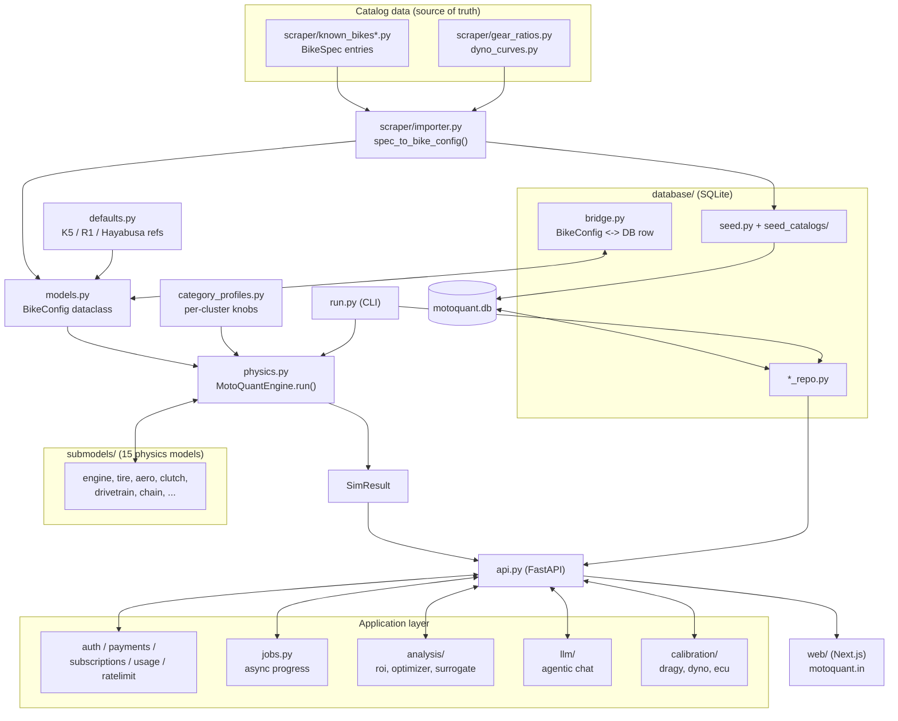

# MotoQuant — Architecture & Module Map

> **Purpose of this file:** the fastest way for a new human or LLM to answer
> *"where does X live and how does data flow through the system?"* without
> reading the 800-line `CLAUDE.md` changelog. Pair it with
> [`docs/ONBOARDING.md`](ONBOARDING.md) (the day-one brief) and
> [`CONTRIBUTING.md`](../CONTRIBUTING.md) (dev workflow).

MotoQuant is a first-principles physics engine that predicts motorcycle
quarter-mile drag-racing times, plus the product surfaces built on top of it
(a CLI, a FastAPI backend, a Next.js web app, and an agentic AI chat). It is a
single Python package (`motoquant/`) with a SQLite catalog (`motoquant.db`)
baked into the repo.

---

## 1. The one diagram



---

## 2. The core data flow, in words

1. **A bike starts as a spec.** Every catalog bike is a `BikeSpec` literal in
   `motoquant/scraper/known_bikes.py` (and the `known_bikes_*.py` sibling
   modules, split by region only to keep files manageable). Specs carry
   headline numbers: power, torque, mass, gearing, tire sizes, aero.

2. **`spec_to_bike_config()` turns a spec into a `BikeConfig`.**
   `motoquant/scraper/importer.py` is the single conversion point. It infers
   physics parameters the spec doesn't state directly (engine inertia,
   parasitic losses, chain pitch, cylinder config, 2-stroke curves), attaches
   real gear cassettes from `gear_ratios.py` and dyno curves from
   `dyno_curves.py`, and derives the `category_tag` (the physics cluster).

3. **`BikeConfig` (in `models.py`) is the universal currency.** Everything
   downstream — the simulator, the DB round-trip, the analysis layer — speaks
   `BikeConfig`. The three **reference bikes** (GSX-R 1000 K5, YZF-R1 4C8,
   Hayabusa Gen1) are hand-curated in `defaults.py`, *not* derived from specs.

4. **`MotoQuantEngine.run()` (in `physics.py`) simulates the run.** It composes
   the 15 sub-models in `submodels/` and integrates the state vector with
   fixed-step RK4 at 1 ms. Per-cluster tuning knobs come from
   `category_profiles.py`. Output is a `SimResult` (ET, trap speed, splits,
   full timeseries).

5. **The DB is a cache of specs + configs, not the source of truth.**
   `database/seed.py` (+ `seed_catalogs/`) writes the catalog into
   `motoquant.db`. `database/bridge.py` round-trips a `BikeConfig` to/from a DB
   row. The `*_repo.py` classes are the only code that touches SQL.
   > ⚠️ **Standing gotcha:** when `spec_to_bike_config` changes, the JSON blobs
   > stored in `bike_configs` go stale and `/api/simulate?bike_id=N` silently
   > diverges from the spec path. Re-run
   > `scripts/reseed_configs_from_specs.py` after any importer/physics change.

6. **`api.py` is the web-facing surface.** FastAPI routes call the engine, the
   repos, and the analysis/LLM/calibration layers. Long-running work (full
   sims, the build optimizer, chat) is dispatched through `jobs.py` for real
   progress bars. `run.py` is the CLI equivalent for the same core.

---

## 3. Subsystem map — what lives where

| Path | Responsibility | Start reading at |
|---|---|---|
| `motoquant/physics.py` | RK4 integrator, the simulation loop | `MotoQuantEngine.run()` |
| `motoquant/submodels/` | 15 independent physics models (engine, tire, aero, clutch, drivetrain, chain, braking, wheelie, weight_transfer, rider_dynamics, staging, environmental, parasitic, rolling_resistance, forced_induction) | any one file — they are small & self-contained |
| `motoquant/models.py` | `BikeConfig` + all parameter dataclasses | `BikeConfig` |
| `motoquant/defaults.py` | The 3 pinned reference bikes + synthetic curves | `gsxr1000_k5()` |
| `motoquant/category_profiles.py` | Per-cluster physics knobs + `derive_category_tag()` | `CategoryProfile` |
| `motoquant/constants.py` | Physical constants, unit conversions | top of file |
| `motoquant/scraper/` | Catalog data (`known_bikes*.py`), `importer.py`, `gear_ratios.py`, `dyno_curves.py`, `validator.py` | `importer.spec_to_bike_config()` |
| `motoquant/database/` | Schema, seed, repos, `bridge.py`, `connection.py` | `connection.py`, then `bike_repo.py` |
| `motoquant/database/seed_catalogs/` | Modular parts/tire/fitment seed data | `__init__` of the subpackage |
| `motoquant/calibration/` | Import real run data (Dragy GPS, dyno CSV, ECU logs), overlay vs sim, auto-calibrate | `dragy.py`, then `overlay.py` |
| `motoquant/analysis/` | Parts ROI, Sobol sensitivity, Bayesian/knapsack build optimizer, ECU autotune, the outlaw pipeline, surrogate models | `roi.py`, then `build_optimizer.py` |
| `motoquant/llm/` | Agentic chat: multi-provider client, tool-calling agent, query parsing, bike estimation, web tools | `agent.py`, `client.py` |
| `motoquant/parts/compatibility.py` | Which parts fit which bikes (tiered matcher) | `is_compatible()` |
| `motoquant/config_io.py` | Save/load a `BikeConfig` to/from a file (must round-trip every physics-read field — see KNOWN_TRAPS T15) | `save_config()` |
<!-- `motoquant/calibration_ml/` removed 2026-08-11: zero production callers (only its own tests imported it). -->
| `motoquant/nlp.py` | Keyless regex natural-language query parser (the `nl` CLI; the fallback when no LLM key is set) | `NLQueryParser` |
| `motoquant/scraper/fetcher.py` | `PoliteFetcher` — dev-only Scrapling-backed scraping (cache → robots.txt → rate limit → tier escalation). Soft-imported; **not** a production dependency | `PoliteFetcher.fetch()` |
| `motoquant/api.py` | FastAPI app + all HTTP routes | grep `@app.` |
| `motoquant/run.py` | CLI (`python -m motoquant.run <subcommand>`) | `main()` |
| `motoquant/auth.py` | Magic-link + password auth, JWT, `require_tier()` | bottom (endpoints) |
| `motoquant/payments.py` `subscriptions.py` | Stripe/Razorpay checkout + webhooks, license keys | webhook handlers |
| `motoquant/usage.py` `ratelimit.py` | Free-tier sim metering, per-IP rate limiting | `usage.py` |
| `motoquant/jobs.py` | In-memory async job registry (progress + cancel) | `create_job()` |
| `motoquant/observability.py` | Sentry wiring (env-gated, no-op without DSN) | top of file |
| `web/` | Next.js frontend (app router, components, `lib/api.js`) | `web/app/page.js` |
| `tests/` | pytest suite (~4,400 tests) | `conftest.py` |
| `scripts/` | Sweeps, reseed, patches, audits, autonomous-ops orchestration | `reseed_configs_from_specs.py` |

---

## 4. "I want to change X" — where to go

| Goal | Files to touch | Don't forget |
|---|---|---|
| Add a bike | `scraper/known_bikes*.py`, then `scripts/reseed_configs_from_specs.py` | run `scripts/audit_headline_stats.py`; validator must pass |
| Tune physics accuracy | `category_profiles.py` (per-cluster knobs) or `submodels/` | **must not** move K5/R1/Hayabusa baselines; regenerate the surrogate |
| Add an API route | `api.py` | add a test in `tests/test_api.py`; for slow work use `jobs.py` |
| Add a part / tire | `database/seed_catalogs/`, then reseed | tighten fitment rules; `tests/test_catalog_integration.py` guards leaks |
| Change auth/billing | `auth.py`, `payments.py`, `subscriptions.py` | `MOTOQUANT_BILLING_ENFORCE` gates enforcement |
| Add a chat capability | `llm/agent.py` (tools), `llm/runner.py` | budget/iteration caps live in the executor |

---

## 5. The non-negotiable invariant

The three reference baselines are **pinned bit-identical** and CI-gated:

```
GSX-R 1000 K5 → 9.9331 s
YZF-R1 4C8    → 10.1436 s
Hayabusa Gen1 → 10.3633 s
```

Any change that perturbs them is a regression, no matter how correct it looks.
Verify after every physics/importer/config change:

```bash
python -c "import motoquant as m; \
print(m.MotoQuantEngine(m.gsxr1000_k5()).run().time_quarter, \
      m.MotoQuantEngine(m.yzfr1_4c8()).run().time_quarter, \
      m.MotoQuantEngine(m.hayabusa_gen1()).run().time_quarter)"
```

---

## 6. Deployment topology (July 2026)

- **API**: FastAPI on **Render** free tier (`motoquant-api.onrender.com`),
  Docker via `render.yaml`. Cold-start-guarded by `keepwarm.py` + a GitHub
  Actions keep-alive cron. Migration runbook: `docs/RENDER_MIGRATION.md`.
- **Web**: Next.js on **Vercel** (`motoquant.in`); reaches the API via the
  `NEXT_PUBLIC_API_URL` env var + an `/api/*` rewrite.
- **DB**: `motoquant.db` is tracked in git and ships inside the Docker image
  (so a deploy currently wipes user accounts until the Render persistent-disk
  flip — see the onboarding "known gaps" list).
- **Desktop app**: DISCONTINUED (July 2026). The `desktop/` scaffold remains
  in-tree for reference only; no binaries are built.
